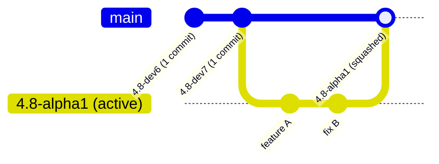

# Lapis Git Release Maintenance & Milestone Tagging Manual

This operational skill governs Git repository hygiene, branch management, and release tagging for the **Lapis for Crystal** project. It enforces the **single-commit-per-milestone invariant** to ensure clean commit graphs, predictable version charting, and synchronized remote branches.

---

## Table of Contents
<table>
  <thead>
    <tr>
      <th align="left">Section</th>
      <th align="left">Description</th>
      <th align="center">Lines</th>
    </tr>
  </thead>
  <tbody>
    <tr>
      <td><a href="#1-architectural-invariant-single-commit-per-release-milestone"><strong>1. Architectural Invariant: Single Commit per Release Milestone</strong></a></td>
      <td>To keep repository history clean and prevent GitHub from reporting "200+ commits ahead" or displaying clutt...</td>
      <td align="center"><code>L57–L85</code></td>
    </tr>
    <tr>
      <td><a href="#2-godot-version-tag-classification-lifecycle-stages"><strong>2. Godot Version Tag Classification & Lifecycle Stages</strong></a></td>
      <td>Lapis tracks upstream Godot Engine release stages.</td>
      <td align="center"><code>L86–L134</code></td>
    </tr>
    <tr>
      <td><a href="#3-milestone-squashing-release-runbook"><strong>3. Milestone Squashing & Release Runbook</strong></a></td>
      <td>Follow these exact steps when finalizing a release milestone:</td>
      <td align="center"><code>L135–L211</code></td>
    </tr>
    <tr>
      <td><a href="#4-upgrading-to-a-new-milestone-version-finalizing-previous-milestone-on-master"><strong>4. Upgrading to a New Milestone Version (Finalizing Previous Milestone on `master`)</strong></a></td>
      <td>When transitioning from a completed milestone (e.g.</td>
      <td align="center"><code>L212–L254</code></td>
    </tr>
    <tr>
      <td><a href="#5-auditing-diagnostic-commands"><strong>5. Auditing & Diagnostic Commands</strong></a></td>
      <td>Use these commands to verify repository health and diagnose commit inflation:</td>
      <td align="center"><code>L255–L297</code></td>
    </tr>
    <tr>
      <td><a href="#6-disaster-recovery-rollback-protocol"><strong>6. Disaster Recovery / Rollback Protocol</strong></a></td>
      <td>If a squash or reset was performed erroneously before pushing:</td>
      <td align="center"><code>L298–L310</code></td>
    </tr>
  </tbody>
</table>

---

## 1. Architectural Invariant: Single Commit per Release Milestone

To keep repository history clean and prevent GitHub from reporting "200+ commits ahead" or displaying cluttered graph branches:

1. **Every finalized release milestone branch and tag must contain exactly ONE commit for that milestone**:
   - The tree of that single commit contains 100% of the files and features finalized for that release.
   - The parent of the commit points directly to the previous milestone commit, creating an unbroken, linear history chain.
2. **Active milestone branches may accumulate iterative commits during development**:
   - Granular commits are permitted while features and fixes are actively being verified on CI.
   - Upon finalization and tagging, all iterative commits are squashed down into the single milestone commit.
3. **Branch, Tag & `master` Finalization Lifecycle**:
   - The milestone branch (e.g. `4.8-beta2`) and its release tag point to the exact same squashed commit hash.
   - Committing to a milestone branch automatically builds and deploys version-isolated documentation and benchmarks to `https://sol-vin.github.io/lapis/<VERSION>/` (e.g. `https://sol-vin.github.io/lapis/4.8-beta2/`).
   - **`master` Finalization on Version Upgrade**: While a milestone is active, day-to-day commits stay on the active milestone branch (`<VERSION>`). When upgrading `lapis` to the *next* Godot version (`<NEW_VERSION>`), you **MUST FIRST pull/fast-forward the completed `<PREVIOUS_VERSION>` branch into `master`** (`git checkout master && git merge --ff-only <PREVIOUS_VERSION>`), push `origin/master`, and verify that CI and the release pass on `master` before cutting `<NEW_VERSION>` from `master`.



---

## 2. Godot Version Tag Classification & Lifecycle Stages

Lapis tracks upstream Godot Engine release stages. When creating branches, tagging milestones, or running benchmarks, use the standardized stage nomenclatures:

<table>
  <thead>
    <tr>
      <th align="left">Stage</th>
      <th align="left">Format Pattern</th>
      <th align="left">Lifecycle &amp; Freeze State</th>
      <th align="left">Examples</th>
    </tr>
  </thead>
  <tbody>
    <tr>
      <td><strong>Development</strong></td>
      <td><code>X.Y-devN</code></td>
      <td>Active exploratory development, major subsystem refactoring, new C-API bindings.</td>
      <td><code>4.8-dev6</code>, <code>4.8-dev7</code></td>
    </tr>
    <tr>
      <td><strong>Alpha</strong></td>
      <td><code>X.Y-alphaN</code></td>
      <td>Feature freeze begins. Subsystem APIs are stabilized; binding generation locked down.</td>
      <td><code>4.8-alpha1</code>, <code>4.8-alpha2</code></td>
    </tr>
    <tr>
      <td><strong>Beta</strong></td>
      <td><code>X.Y-betaN</code></td>
      <td>Feature freeze complete. Intense bug squashing, performance benchmarks, and docs.</td>
      <td><code>4.8-beta1</code>, <code>4.8-beta3</code></td>
    </tr>
    <tr>
      <td><strong>Release Candidate</strong></td>
      <td><code>X.Y-rcN</code></td>
      <td>Production candidate. Only critical blocker bug fixes and security patches allowed.</td>
      <td><code>4.8-rc1</code>, <code>4.8-rc2</code></td>
    </tr>
    <tr>
      <td><strong>Stable</strong></td>
      <td><code>X.Y-stable</code> / <code>X.Y.Z-stable</code></td>
      <td>Official production shipping release. Long-term support baseline.</td>
      <td><code>4.8-stable</code>, <code>4.8.1-stable</code></td>
    </tr>
  </tbody>
</table>

---

## 3. Milestone Squashing & Release Runbook

Follow these exact steps when finalizing a release milestone:

### Step 1: Pre-Flight Verification & Quality Gates
Before squashing any branch, all tests and builds must pass green:
```powershell
# 1. Full compilation and synchronization
make all

# 2. Automated test suite execution
bin/lapis test --no-tui

# 3. Godot version matching verification
crystal run spec/godot_version_verification_spec.cr

# 4. Environment health check
bin/lapis doctor
```

### Step 2: Synchronize Milestone Version (`0.Y.X`) & Commit Working Tree Changes
Ensure `shard.yml`, `tools/lapis/shard.yml`, and `README.md` reflect `0.Y.X` where `0.Y` is the minor version for this Godot milestone (bumped from `0.(Y-1)` when branching off `master`) and `X` is the number of commits in the current branch (`git rev-list --count master..HEAD`):
```powershell
git add -A
git commit -m "chore: prepare final release assets for <STAGE-VERSION>"
```

### Step 3: Create the Single Squashed Milestone Commit
Using `git commit-tree` guarantees 100% byte-for-byte tree identity with zero file loss:

```powershell
# For a root milestone (first milestone in the chain, e.g. 4.8-dev6):
$Tree = git rev-parse "HEAD^{tree}"
$Commit = git commit-tree $Tree -m "feat: Godot <VERSION> release (<SUMMARY OF FEATURES>)"

# For subsequent milestones (e.g. 4.8-dev7 with parent 4.8-dev6):
$ParentCommit = git rev-parse "refs/heads/<PREVIOUS_VERSION>"
$Tree = git rev-parse "HEAD^{tree}"
$Commit = git commit-tree $Tree -p $ParentCommit -m "feat: Godot <VERSION> release (<SUMMARY OF FEATURES>)"
```

### Step 4: Update Branch and Release Tags Locally
Reset the current branch and point release tags to the new squashed commit:
```powershell
# Reset current branch to the squashed commit
git reset --hard $Commit

# Update branch ref and version tag
git branch -f <VERSION> $Commit
git tag -f <VERSION> $Commit

# Update floating latest tag and master branch
git tag -f latest $Commit
git branch -f master $Commit
```

### Step 5: Verify Tree Integrity & Commit Counts
Mathematically verify zero file drift and exact commit counts:
```powershell
# 1. Commit count of target milestone branch relative to its parent (MUST be 1):
git rev-list --count refs/heads/<PREVIOUS_VERSION>..refs/heads/<VERSION>
# Expected: 1

# 2. Tree diff against pre-squash HEAD (MUST produce zero output):
git diff ORIG_HEAD HEAD
# Expected: (empty)
```

### Step 6: Push to Remote & Verify CI / Versioned Docs
Force-push the milestone branch and its release tag to GitHub, then verify the `Release` workflow and versioned GitHub Pages (`https://sol-vin.github.io/lapis/<VERSION>/`) pass:
```powershell
git push -f origin <VERSION>
git push -f origin refs/tags/<VERSION>
```

---

## 4. Upgrading to a New Milestone Version (Finalizing Previous Milestone on `master`)

When transitioning from a completed milestone (e.g. `4.8-beta1`) to the next Godot version (e.g. `4.8-beta2`):

1. **Pull the Previous Milestone into `master` to Finalize It**:
   ```powershell
   git checkout master
   git merge --ff-only <PREVIOUS_VERSION>
   git push origin master
   ```
   - Wait for and verify that the `Release` workflow on `master` passes 100%, publishing the finalized `<PREVIOUS_VERSION>` / `latest` release and deploying root docs (`https://sol-vin.github.io/lapis/`) and `https://sol-vin.github.io/lapis/<PREVIOUS_VERSION>/`.
2. **Check Out the New Milestone Branch from `master`**:
   ```powershell
   git checkout -b <NEW_VERSION> master
   ```
3. **Update Version Configuration & Bump Lapis Minor Version (`0.Y.0`)**:
   - Bump Lapis minor version and reset commit counter to `0` (`0.(Y-1).Z` -> `0.Y.0`, e.g. `0.1.19` -> `0.2.0`) in `shard.yml`, `tools/lapis/shard.yml`, and `README.md` (performed automatically by `lapis setup <NEW_VERSION>` and `.githooks/pre-commit`).
   - Update `godot-version.yml`, `template/godot-version.yml`, and `template-addon/godot-version.yml`:
     ```yaml
     version: "<NEW_VERSION>"
     ```
   - Update `src/bridge/godot_version.h`:
     ```c
     #define LIBGODOT_TARGET_VERSION "<NEW_VERSION>"
     ```
   - Update default `godot-version` and `lapis-ref` in `.github/workflows/reusable-lapis-ci.yml`, `.github/workflows/build-addon.yml`, `.github/workflows/build-game.yml`, `.github/actions/*/action.yml`, and `tools/lapis/src/ci/dsl.cr`.
4. **Verify Version Alignment & Specs**:
   ```powershell
   crystal run spec/godot_version_verification_spec.cr
   crystal spec tools/lapis/spec/
   ```
5. **Create Single Milestone Commit, Push & Verify CI**:
   ```powershell
   git add -A
   git commit -m "feat: Godot <NEW_VERSION> release"
   git tag -f <NEW_VERSION> HEAD
   git push -u origin <NEW_VERSION>
   git push -f origin refs/tags/<NEW_VERSION>
   ```
   - Verify that the `Release` workflow on `<NEW_VERSION>` passes 100% and deploys `https://sol-vin.github.io/lapis/<NEW_VERSION>/`.

---

## 5. Auditing & Diagnostic Commands

Use these commands to verify repository health and diagnose commit inflation:

<table>
  <thead>
    <tr>
      <th align="left">Audit Goal</th>
      <th align="left">Command</th>
      <th align="left">Expected Result</th>
    </tr>
  </thead>
  <tbody>
    <tr>
      <td>Milestone Commit Count</td>
      <td><code>git rev-list --count refs/heads/4.8-dev6</code></td>
      <td><code>1</code> (for root milestone)</td>
    </tr>
    <tr>
      <td>Delta between Milestones</td>
      <td><code>git rev-list --count refs/heads/4.8-dev6..refs/heads/4.8-dev7</code></td>
      <td><code>1</code> (exactly 1 commit ahead)</td>
    </tr>
    <tr>
      <td>Inspect Commit Graph</td>
      <td><code>git log --graph --oneline --decorate -n 10</code></td>
      <td>Clean linear sequence with tags aligned</td>
    </tr>
    <tr>
      <td>Verify Remote Status</td>
      <td><code>git status -uno</code></td>
      <td><code>Your branch is up to date with 'origin/...'</code></td>
    </tr>
    <tr>
      <td>Check Tag Ambiguity</td>
      <td><code>git show-ref 4.8-dev7</code></td>
      <td>Both branch and tag point to identical commit hash</td>
    </tr>
  </tbody>
</table>

---

## 6. Disaster Recovery / Rollback Protocol

If a squash or reset was performed erroneously before pushing:
1. Locate the pre-squashed commit hash in Git's reference log:
   ```powershell
   git reflog -n 20
   ```
2. Restore the branch to the exact pre-squashed commit:
   ```powershell
   git reset --hard <PRE_SQUASH_HASH>
   ```
3. Re-verify the workspace with `git status` and `make all`.
